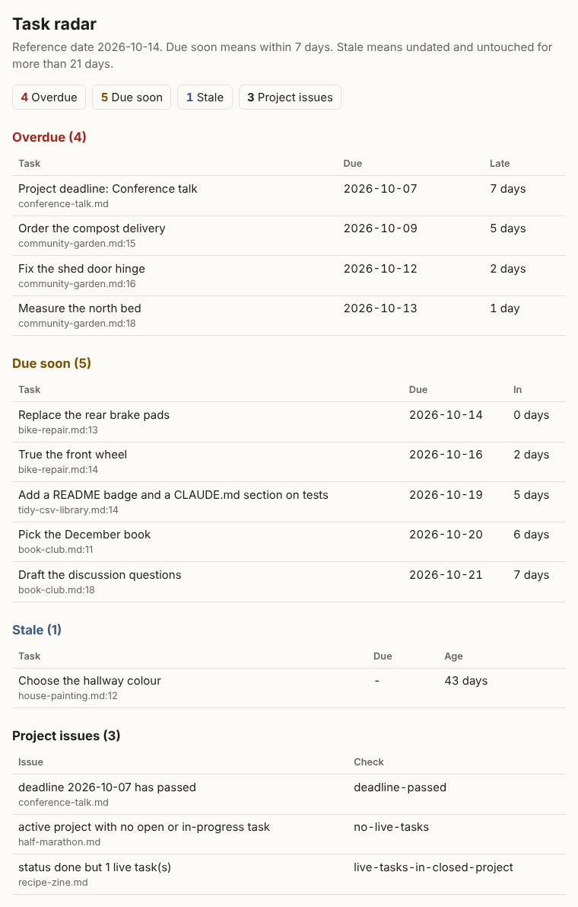

# plaintext-task-radar

`taskradar` reads a folder of Markdown project notes and reports overdue, due-soon, and stale tasks. It
also lints the notes for task markers and dates that no reader would ever see. The notes stay the source
of truth: every report is derived from them and regenerated on each run.



## Why a linter

A task tracker built on plain text fails quietly. Type `[/]` instead of `[~]`, or `📅 29 Sep` instead of
`📅 2026-09-29`, and the task drops out of every report. Nothing errors. The radar simply goes quiet
exactly when it should not. `taskradar lint` turns those slips into findings with a suggested fix, and it
exits 1 so it can guard a notes repository as a pre-commit hook.

## Install

Python 3.11 or later. The only runtime dependency is PyYAML.

```bash
pipx install git+<REPO_URL>
```

Or from a clone:

```bash
git clone <REPO_URL> plaintext-task-radar
cd plaintext-task-radar
pipx install .
```

## Quick start

The repository ships an invented demo vault with one of each edge case planted in it. Its expected
counts are written down in `examples/demo-vault/EXPECTED.md`.

```console
$ taskradar lint examples/demo-vault
bike-repair.md:15: L001 error: [/] is not one of the six markers (fix: use [~])
book-club.md:11: L005 warning: task line outside '## Tasks' (fix: move it under '## Tasks')
book-club.md:16: L004 error: delegated task names nobody (fix: add @name)
book-club.md:17: L001 error: [X] is not one of the six markers (fix: use [x])
conference-talk.md:15: L002 error: '📅 29' is not a YYYY-MM-DD date (fix: write the date as YYYY-MM-DD)
conference-talk.md:16: L003 error: no space after the bullet, so this is not a task (fix: put a space between the bullet and '[')
tidy-csv-library.md:3: L006 error: frontmatter: status: 'on-hold' is not one of active, paused, done, dropped
7 finding(s): 6 error(s), 1 warning(s)
```

```console
$ taskradar radar examples/demo-vault --today 2026-10-14
Radar for 2026-10-14 (horizon 7 days, stale after 21 days)
Totals: 4 overdue, 5 due soon, 1 stale, 3 project issues

Overdue (4)
  2026-10-07  7 days late   conference-talk.md  Project deadline: Conference talk
  2026-10-09  5 days late   community-garden.md:15  Order the compost delivery
  2026-10-12  2 days late   community-garden.md:16  Fix the shed door hinge
  2026-10-13  1 day late    community-garden.md:18  Measure the north bed

Due soon (5)
  2026-10-14  due today     bike-repair.md:13  Replace the rear brake pads
  2026-10-16  in 2 days     bike-repair.md:14  True the front wheel
  2026-10-19  in 5 days     tidy-csv-library.md:14  Add a README badge and a CLAUDE.md section on tests
  2026-10-20  in 6 days     book-club.md:11  Pick the December book
  2026-10-21  in 7 days     book-club.md:18  Draft the discussion questions

Stale (1)
  43 days since update  house-painting.md:12  Choose the hallway colour

Project issues (3)
  conference-talk.md  deadline-passed: deadline 2026-10-07 has passed
  half-marathon.md  no-live-tasks: active project with no open or in-progress task
  recipe-zine.md  live-tasks-in-closed-project: status done but 1 live task(s)
```

Other options:

- `--json` prints the same report as JSON with a `schema_version` key.
- `--html out/report.html` also writes a single-file HTML report (inline CSS, no scripts, no external
  links).
- `--horizon N` and `--stale-days N` change the due-soon window (default 7) and the stale limit
  (default 21).
- `--fail-on-overdue` exits 2 when anything is overdue, for use in scripts.

## Note format

The full contract is in [docs/FORMAT.md](docs/FORMAT.md). In short:

- One Markdown file per project, with YAML frontmatter: `title`, `status`, `priority`, and optionally
  `deadline`, `updated`, and `owner`.
- Tasks are list items under `## Tasks`, such as `- [ ] Book the hall 📅 2026-10-20 ⏫`.
- Six markers: `[ ]` open, `[~]` in progress, `[x]` done, `[-]` cancelled, `[>]` migrated, and `[d]`
  delegated. Only open and in-progress tasks are live.
- Due dates use `📅 YYYY-MM-DD` (as in the Obsidian Tasks plugin) or the ASCII alias `due:YYYY-MM-DD`.
- Fenced code blocks are ignored, so notes can show bad examples.
- Lint rules L001 to L006 cover unknown markers, malformed dates, a missing space after the bullet,
  delegated tasks with no owner, tasks outside `## Tasks`, and invalid frontmatter.

## Design choices

- **Plain files are the source of truth.** The tool never edits a note. Reports are derived and can be
  thrown away.
- **Reproducible.** `--today` fixes the reference date, so the same notes always give the same output.
  The tests and the golden files depend on it.
- **Live is a whitelist.** Only `[ ]` and `[~]` are on the radar. A new symbol is an error, never an
  accidental open task.
- **Structural matching.** A marker inside backticks, a table cell, or a fenced block is never a task.
- **Small.** One runtime dependency and a core of 438 lines (non-blank, non-comment), measured by
  `tools/check_core_size.py`. CI fails the build above 500.
- **Every gate has a control.** The tests show each check failing on a planted case, including fenced
  and footnote twins, the 7 versus 8 day boundary, and the hooks below.

## Development

```bash
python -m venv .venv
.venv/bin/python -m pip install -e ".[dev]"
.venv/bin/python -m pytest -q
.venv/bin/ruff check .
.venv/bin/python tools/check_core_size.py
```

The repository carries its own commit hooks in `scripts/hooks/`. Enable them with
`git config core.hooksPath scripts/hooks`. They refuse secret-like strings, private network addresses,
home directory paths, and personal email addresses, and they read an extra list of private terms from
the file named by the `PORTFOLIO_DENYLIST` environment variable. Without that list they refuse every
commit, so they fail closed.

## Limitations

- No recurring tasks, times of day, or time zones. Dates are whole calendar days.
- Stale detection needs an `updated` date in the frontmatter or git history. File modification times
  are a weak fallback, because a fresh clone resets them.
- Notes are read one at a time. There is no cross-note linking or task propagation.
- English signifiers and ISO dates only.

## Licence

MIT. See [LICENSE](LICENSE).
